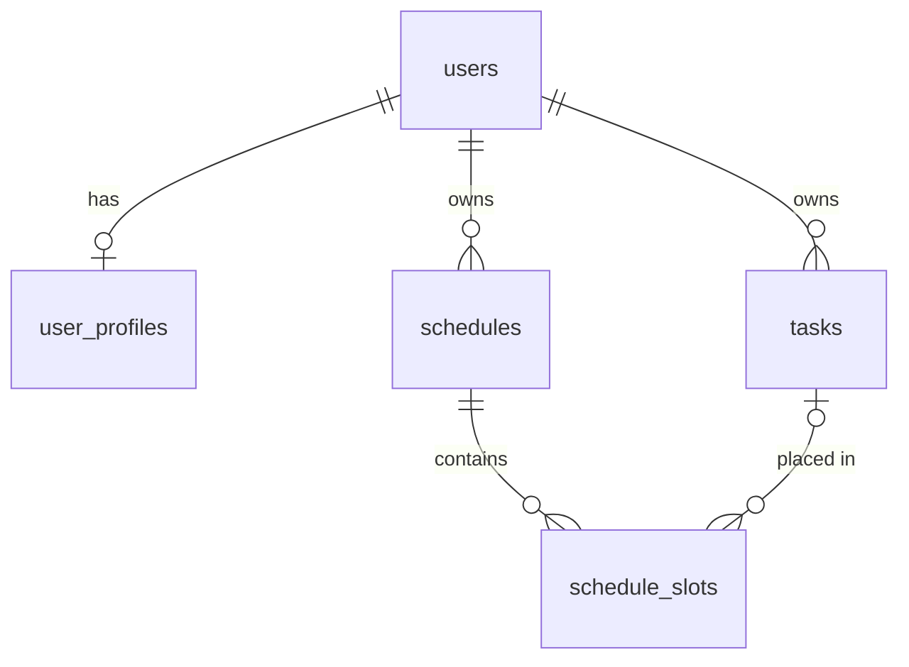

# Схема базы данных

PostgreSQL 16. Модели — `app/modules/*/models.py`, миграции — `app/db/migrations/versions/`. Время хранится в UTC ([ADR 0002](adr/0002-utc-time.md)), значения биоритмов не хранятся ([ADR 0003](adr/0003-biorhythms-computed-not-stored.md)).

## ER-диаграмма



## Таблицы

| Таблица | Назначение | Ключевые поля |
|---|---|---|
| `users` | учётная запись | `email citext UNIQUE`, `password_hash`, `is_email_verified`, `deleted_at` |
| `user_profiles` | профиль 1:1, исходные данные для биоритмов и планировщика | `birth_date`, `birth_time`, `birth_tz`, `birth_at_utc`, `chronotype`, `timezone`, режим сна, обед, рабочее окно, `work_days` |
| `tasks` | задачи пользователя | `type`, `priority`, `duration_min`, `planned_date`, `is_pinned`/`pinned_start`, `status`, факт выполнения, `version`, `deleted_at` |
| `schedules` | версия плана на день | `date`, `version`, `is_active`, `algorithm_version`, `trigger`, `critical_level`, `load_factor`, `summary jsonb` |
| `schedule_slots` | интервалы плана | `kind`, `task_id`, `start_at`/`end_at`, `score`, `reason_codes`, `explanation` |

## Перечисления

| Тип | Значения |
|---|---|
| `chronotype` | `lark`, `dove`, `owl` |
| `chronotype_source` | `manual`, `quiz` |
| `task_type` | `intellectual`, `physical`, `creative`, `routine` |
| `task_priority` | `high`, `medium`, `low` |
| `task_status` | `pending`, `scheduled`, `done`, `skipped` |
| `schedule_trigger` | `initial`, `task_created`, `task_updated`, `task_deleted`, `status_changed`, `manual_edit`, `profile_changed`, `nightly` |
| `slot_kind` | `task`, `break`, `lunch`, `rest` |

## Ограничения целостности

| Ограничение | Правило |
|---|---|
| `ck_user_profiles_birth_date_range` | дата рождения не раньше 1900-01-01 |
| `ck_user_profiles_lunch_duration_range` | обед 0–180 мин |
| `ck_user_profiles_work_window` | `work_end > work_start` |
| `ck_user_profiles_work_days_range` | дни недели только 1–7 |
| `ck_user_profiles_onboarding_requires_birth_data` | завершённый онбординг требует даты рождения, `birth_at_utc` и хронотипа |
| `ck_tasks_duration_range` | длительность 5–480 мин |
| `ck_tasks_title_not_blank` | название не пустое |
| `ck_tasks_pinned_requires_start` | закреплённая задача имеет `pinned_start` |
| `ck_tasks_done_requires_completed_at` | выполненная задача имеет `completed_at` |
| `ck_tasks_actual_interval` | `actual_end > actual_start` |
| `uq_schedules_user_id_date_version` | версии плана на день уникальны |
| `uq_schedules_active_per_day` | частичный уникальный индекс: одна активная версия на день |
| `ck_schedules_critical_level_range` | уровень критичности 0–3 |
| `ck_schedules_load_factor_range` | `0 < load_factor ≤ 1` |
| `ck_schedule_slots_interval` | `end_at > start_at` |
| `ck_schedule_slots_only_task_slots_reference_tasks` | перерыв, обед и отдых не ссылаются на задачу |

## Удаление

- Все дочерние таблицы удаляются каскадно вместе с `users` (удаление аккаунта).
- Удаление задачи обнуляет `schedule_slots.task_id` (`ON DELETE SET NULL`). В обычной работе задачи удаляются мягко через `deleted_at`.

## Индексы

| Индекс | Зачем |
|---|---|
| `ix_tasks_user_id_planned_date` (`WHERE deleted_at IS NULL`) | задачи пользователя на день |
| `ix_tasks_user_id_updated_at` | офлайн-синхронизация по курсору |
| `ix_schedule_slots_schedule_id_start_at` | слоты версии по порядку |
| `ix_schedule_slots_task_id` | FK для `ON DELETE SET NULL` |

## Именование

Соглашение задано в `app/db/base.py`: `pk_<table>`, `fk_<table>_<column>_<referred>`, `uq_<table>_<columns>`, `ix_<table>_<columns>`, `ck_<table>_<name>`. Миграции получают его через `target_metadata`, поэтому в них указываются только короткие имена CHECK-ограничений.

## Работа с миграциями

Все команды выполняются из `backend/`. Для локальных команд нужны окружение после `uv sync --frozen`, корректный `DATABASE_URL` и доступный PostgreSQL. Подготовка окружения и адреса сервисов описаны в [README](../../README.md).

### Существующая цепочка

| Ревизия | Содержимое |
|---|---|
| `0001` | расширение `citext` |
| `0002` | `users`, `user_profiles` |
| `0003` | `tasks` |
| `0004` | `schedules`, `schedule_slots` |

В PostgreSQL 16 используется встроенная `gen_random_uuid()`; отдельная установка `pgcrypto` для этих миграций не нужна. При первом создании PostgreSQL volume скрипт `docker/postgres/init/01-extensions.sql` также создаёт `citext`, поэтому миграция использует `IF NOT EXISTS`.

Опубликованные ревизии не переименовываются и не переписываются. Изменения схемы оформляются новой миграцией поверх текущей head.

### Применение и проверка

При `docker compose up -d --build` сервис `migrate` автоматически выполняет upgrade до head перед запуском API, worker и beat. Эта команда изменяет БД текущего Compose-проекта. Повторное явное применение уже выполненных миграций допустимо:

```powershell
docker compose run --rm migrate alembic upgrade head
docker compose exec -T api alembic current
docker compose exec -T api alembic check
```

Последние две команды предполагают запущенный API. Вариант для локального окружения:

```powershell
$env:DEBUG = "false"
uv run alembic heads
uv run alembic history
uv run alembic current
uv run alembic check
```

`heads` и `history` показывают файлы ревизий, а `current` — состояние выбранной БД. `check` сравнивает БД с ORM-моделями без применения миграций, включая типы и серверные значения по умолчанию.

### Добавление модели и миграции

1. Создайте или измените модель в `app/modules/<module>/models.py`, используя общую `Base` и существующие соглашения об ограничениях.
2. Импортируйте новую модель в `app/db/models.py`, чтобы её таблица попала в metadata Alembic.
3. На локальной БД разработки примените существующие миграции до head и создайте новую ревизию:

   ```powershell
   uv run alembic upgrade head
   uv run alembic revision --autogenerate -m "описание изменения"
   ```

4. Проверьте сгенерированный файл: `down_revision`, операции `upgrade()` и `downgrade()`, типы, индексы, ограничения и defaults. Автогенерация требует ручной проверки; особенно внимательно проверяйте переименования, операции с enum и преобразование существующих данных.
5. Проверьте новую миграцию на одноразовой БД: применение, откат и повторное применение. Затем выполните `alembic check` и полный набор тестов.
6. После проверки включите модель, её импорт, миграцию и необходимые тесты в один коммит.

Автогенерацию выполняйте локально: так новый файл сразу появится в репозитории. Сравнение с БД должно выполняться на актуальной схеме без посторонних таблиц.

### Проверка отката

**Команды ниже предназначены только для одноразовой тестовой БД, выбранной через локальный `DATABASE_URL`.** `downgrade base` удаляет все таблицы цепочки и расширение `citext`. Не выполняйте его на общей БД или базе с нужными данными.

```powershell
uv run alembic upgrade head
uv run alembic downgrade base
uv run alembic upgrade head
uv run alembic check
```

Эту последовательность и соответствие схемы моделям также проверяют тесты в `tests/db/`, использующие собственный PostgreSQL через Testcontainers:

```powershell
uv run pytest tests/db
```

Обычный `docker compose down` сохраняет volumes. Не добавляйте `--volumes` для рабочего проекта: это удалит сохранённые данные PostgreSQL и Redis.

Таблицы `sessions`, `email_tokens`, уведомлений и периодических задач добавляются отдельными миграциями на соответствующих этапах.
